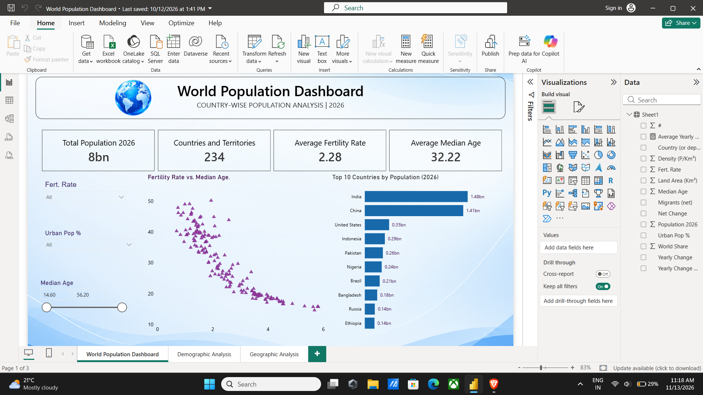
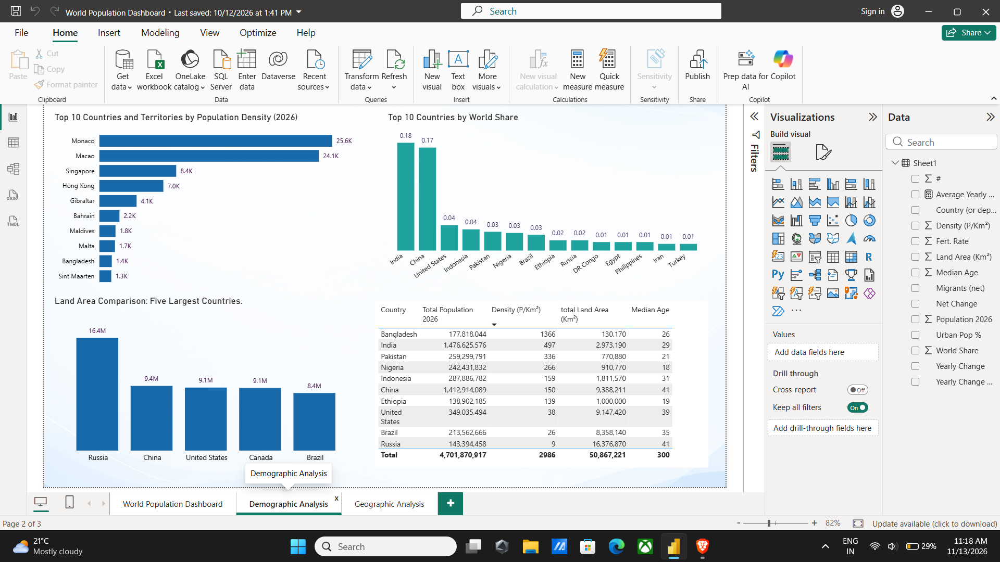

## 📂 Dataset

This project uses country-level population and demographic data covering 234 countries and territories.

The dataset includes:
- Population (2026)
- Population density
- Fertility rate
- Median age
- Land area
- Urban population
- World population share

**Data reference:** [United Nations – World Population Prospects](https://population.un.org/wpp/)

The official UN source provides population estimates and projections for demographic analysis. Additional indicators may require supplementary data sources or data processing.

## 📊 Dashboard Preview

### 1. World Population Dashboard

### 2. Demographic Analysis

### 3. Geographic Analysis

