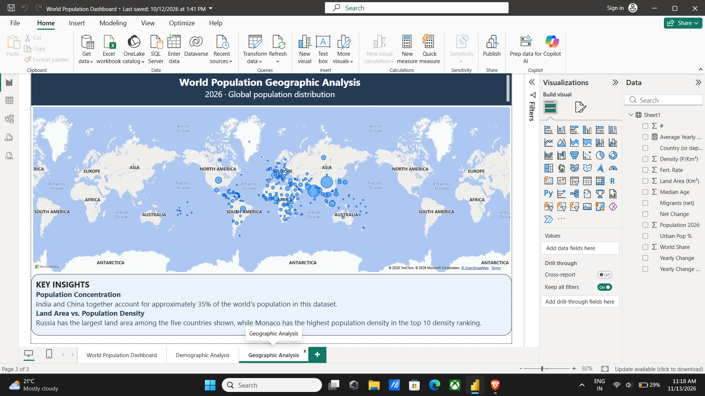

## 📂 Dataset

This project uses country-level population and demographic data covering 234 countries and territories.

The dataset includes:
- Population (2026)
- Population density
- Fertility rate
- Median age
- Land area
- Urban population
- World population share

**Data reference:** [United Nations – World Population Prospects](https://population.un.org/wpp/)

The official UN source provides population estimates and projections for demographic analysis. Additional indicators may require supplementary data sources or data processing.

## 📊 Dashboard Preview

### 1. World Population Dashboard

### 2. Demographic Analysis

### 3. Geographic Analysis

## 🔍 Key Insights

- **Population Leaders:** India and China have the largest populations globally.
- **Population Distribution:** A small group of countries accounts for a substantial share of the world's population.
- **Fertility vs. Median Age:** The dashboard shows a negative relationship between fertility rates and median age.
- **Population Density:** Population density varies significantly across countries.
- **Land Area Comparison:** Countries with larger land areas do not necessarily have higher population density.

## 💡 Conclusion

This dashboard provides an interactive overview of global population patterns, demographic indicators, and geographical differences using Power BI.

## 🛠️ Tools & Technologies

- Power BI Desktop
- Power Query – Data Cleaning and Transformation
- DAX – Measures and Calculations
- Data Visualization
- Exploratory Data Analysis (EDA)
- Microsoft Excel
